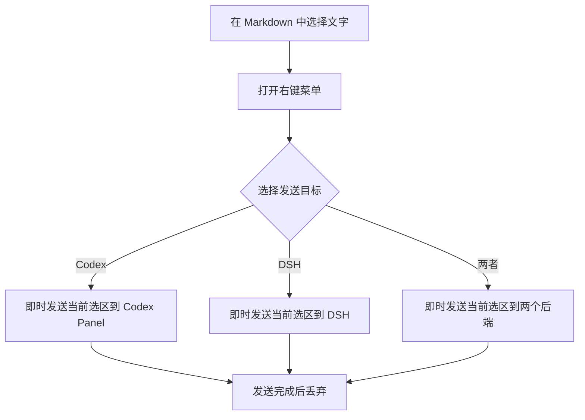
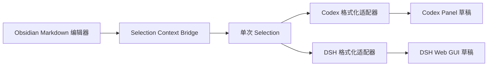

# Selection Context Bridge

| 项目 | 内容 |
| --- | --- |
| 插件 ID | `selection-context-bridge` |
| 当前版本 | `0.2.0` |
| 最低 Obsidian 版本 | `1.7.2` |
| 运行环境 | Obsidian 桌面端 |
| 最后更新时间 | 2026-10-13 |

Selection Context Bridge 是一个独立的 Obsidian 插件。在 Markdown 笔记中选择文字后，可以通过右键菜单将当前选区即时发送到 Codex Panel、DeepSeek Harness（DSH），或同时发送到两者。

插件用于替代直接修改 `codex-panel` 或 `dsh-harness` 源码的旧方案：选区采集、章节范围计算、格式转换和发送适配全部位于本插件中，第三方插件升级时不需要重新合并选区功能。

## 功能

- 支持在 Markdown 编辑模式和阅读模式中通过右键菜单即时发送当前选区。
- 支持从当前光标所在标题计算章节范围，并发送到 Codex Panel。
- 支持发送到 Codex Panel、DSH 或两者。
- 不缓存选区，不跨操作累计上下文。
- 不修改笔记内容，不需要构建步骤，也不直接修改后端插件源码。
- 后端未启用、面板未就绪或版本不兼容时显示明确提示，不阻止 Obsidian 加载。

## 安装

1. 将本目录复制到 Vault 的插件目录：

	```text
	<Vault>/.obsidian/plugins/selection-context-bridge/
	```

2. 确认目录中至少包含：

	```text
	selection-context-bridge/
	├── manifest.json
	├── main.js
	└── README.md
	```

3. 在 Obsidian 的“设置 → 第三方插件”中启用 `Selection Context Bridge`。
4. 根据使用目标启用 `codex-panel`、`dsh-harness`，或同时启用两者。

插件为单文件 JavaScript 实现，无需安装 npm 依赖或执行构建命令。

## 使用

### 即时发送选区

1. 在 Markdown 笔记中选择一段文字。
2. 打开右键菜单并选择目标：
	- `选区桥接：发送当前选区到 Codex`
	- `选区桥接：发送当前选区到 DSH`
	- `选区桥接：发送当前选区到 Codex + DSH`
3. 插件只发送这一次操作对应的选区，发送完成后立即丢弃。

### 发送当前章节

在 Markdown 编辑模式中，将光标放在章节标题或章节正文内，打开右键菜单并选择 `选区桥接：发送当前章节到 Codex`。插件会找到光标上方最近的 Markdown 标题，并将内容范围计算到下一个同级或更高级标题之前；代码围栏内的伪标题不会被当作章节边界。

Codex 草稿只写入笔记链接和精确行号范围，例如 `[[文档/示例]] (L10:C1-L18:C1)`，不会把整个章节正文复制到输入框。

### 命令面板

| 命令 | 行为 |
| --- | --- |
| `发送当前选区` | 按设置中的默认目标发送当前编辑器选区 |
| `发送当前章节到 Codex` | 计算当前 Markdown 章节范围并发送到 Codex Panel |

命令面板中的 `发送当前选区` 会直接读取当前编辑器选区，不需要预先收集。

### 设置

在插件设置页可以：

- 将命令面板的默认发送目标设置为 `Codex Panel`、`DSH` 或 `Codex + DSH`。

## 工作流程



## 架构设计



核心职责如下：

| 模块 | 职责 |
| --- | --- |
| 选区采集 | 获取 Vault 相对路径、选中文本和编辑模式下的精确行列范围 |
| 章节范围解析器 | 根据当前光标和 Markdown 标题计算单个章节范围 |
| Codex 适配器 | 优先调用公开的 `selectionContext` API，必要时回退到运行时草稿控制器 |
| DSH 适配器 | 优先调用公开的 `selectionContext` API，必要时回退到 DSH 桥接和草稿填充能力 |
| 设置页 | 保存默认发送目标 |

## 数据格式

### 选区数据

每次发送的 selection 主要字段为：

```typescript
interface CollectedSelection {
  path: string;
  linktext: string;
  range: {
	 from: { line: number; ch: number };
	 to: { line: number; ch: number };
  } | null;
  text: string;
  marker: string;
  key: string;
}
```

| 字段 | 说明 |
| --- | --- |
| `path` | Vault 内的 Markdown 相对路径 |
| `linktext` | 去除 `.md` 扩展名后的笔记链接文本 |
| `range` | 编辑模式中的 0 基行列范围；阅读模式下为 `null` |
| `text` | 用户主动选择的原文 |
| `marker` | 用于 Codex 的笔记链接和位置标记 |
| `key` | 由路径、范围和文本组成的去重键 |

插件不保存选区缓存；发送完成后不会保留上一条 selection。

### Codex 消息

编辑模式下，Codex 使用笔记链接和精确行列位置，例如：

```text
[[文档/示例]] (L10:C3-L12:C8)
```

如果 Codex Panel 暴露选区上下文 API，插件会提交单个结构化选区；否则回退到只包含范围 marker 的聊天草稿。阅读模式无法稳定取得源码行列，因此回退为笔记链接加选中文本。

### DSH 消息

编辑模式下，每条选区包含一行 BRIDGES 位置标记和对应选中文本：

```text
[ BRIDGES is delivering packages for you…… · 12 words · L10:C3-L12:C8 · /absolute/path/to/note.md · ]
选中的文本
```

多条选区使用相同格式依次拼接。DSH 可从标记中获得绝对路径、行列范围和字数，同时也能直接读取随消息发送的选中文本。

> 旧的 B 方案只发送路径、行列范围和字数，由 DSH 再读取文件。本独立插件为兼容不同 DSH 版本，会同时发送位置标记和用户已选择的文本。

## 交互与异常处理

| 场景 | 处理方式 |
| --- | --- |
| 当前没有选中文本 | 隐藏当前选区发送项；章节发送项仍可用 |
| 当前光标不在章节内 | 提示当前光标所在位置没有 Markdown 章节标题 |
| Codex Panel 未启用 | 显示未检测到 Codex Panel 的提示 |
| Codex 聊天面板未就绪 | 显示面板尚未准备好的提示 |
| DSH Harness 未启用 | 显示未检测到 DSH Harness 的提示 |
| DSH 桥接未就绪 | 提示稍候重试 |
| 某个目标发送失败 | 显示对应错误；选择双目标时继续尝试另一个目标 |

## 兼容说明

- 插件仅支持 Obsidian 桌面端。
- 编辑模式支持精确行列位置；阅读模式只能可靠获取笔记路径和选中文本。
- 插件通过运行时能力探测连接 Codex Panel 和 DSH。优先使用后端公开 API，并保留针对旧版本的兼容回退。
- 第三方后端若修改内部接口，插件会提示“面板尚未准备好”或“不支持”，不会阻止 Obsidian 加载。
- DSH 使用绝对路径定位文件，目标 DSH 进程必须能够访问当前 Vault。
- Windows 与 macOS 的路径格式和启动命令不同，不能直接复制包含本机绝对路径的后端配置。

## 跨设备同步

### 通用步骤

1. 在目标设备安装 Obsidian，并打开需要使用的 Vault。
2. 将整个 `selection-context-bridge` 目录复制到目标 Vault 的 `.obsidian/plugins/` 下。
3. 在 Obsidian 中启用 Selection Context Bridge。
4. 安装并启用 Codex Panel、DSH Harness，或所需的其中一个后端。
5. 在 Markdown 文件中选择文字并执行右键发送。
6. 确认目标聊天草稿只包含本次操作的选区上下文。
7. 在另一个位置再次发送，确认前一次选区不会被带入。

### Windows 注意事项

- 不要复制 macOS 的 Node.js、NVM、DSH CLI 或 Vault 绝对路径配置。
- 如果 DSH Harness 需要启动命令，应填写 Windows 上实际存在的 `node.exe` 或 `dsh` 路径。
- DSH 服务启动后，如后端提供“重新写入”或“重启服务”操作，应在目标设备重新执行，让运行时桥接文件使用 Windows 路径生成。
- 验收时检查 BRIDGES 标记中的文件路径是否为 Windows 可访问的绝对路径。

## 验收清单

### 基础功能

- [ ] 插件可在 Obsidian 第三方插件列表中启用。
- [ ] 编辑模式选中文字后，右键菜单显示三个即时发送目标和当前章节入口。
- [ ] 阅读模式选中文字后，右键菜单显示相同入口。
- [ ] 命令面板可以发送当前选区或当前章节。
- [ ] 设置页可以切换默认发送目标。

### Codex Panel

- [ ] 单个编辑模式选区包含笔记链接和精确行列范围。
- [ ] Codex 草稿只包含当前选区的笔记链接和范围。
- [ ] Codex Panel 未启用或面板未就绪时显示明确提示。

### DSH

- [ ] 单个编辑模式选区包含 BRIDGES 标记、绝对路径和选中文本。
- [ ] 当前选区包含 BRIDGES 标记、绝对路径和选中文本。
- [ ] DSH Harness 未启用、桥接未就绪或版本不兼容时显示明确提示。

### 无缓存行为

- [ ] 发送后插件不保留选区。
- [ ] 下一次发送不会包含上一次选区。
- [ ] 重载插件或重启 Obsidian 后行为一致。

## 风险与限制

| 风险或限制 | 影响 | 应对方式 |
| --- | --- | --- |
| 章节标题或文件在发送前发生变化 | 已计算的行列范围可能漂移 | 在内容稳定后发送，必要时重新执行章节命令 |
| 第三方插件内部接口变化 | 兼容回退可能失效 | 优先推动后端提供稳定的 `selectionContext` API |
| DSH 进程无法访问 Vault 路径 | DSH 无法按标记重新读取文件 | 确保 DSH 与 Vault 位于同一可访问环境 |
| 阅读模式没有精确源码位置 | 只能发送链接和选中文本 | 需要精确范围时在编辑模式中选择 |

## 后续扩展

新增后端时，实现对应发送适配器并加入目标解析和右键菜单即可；选区采集、章节范围解析和格式化能力可以继续复用。
